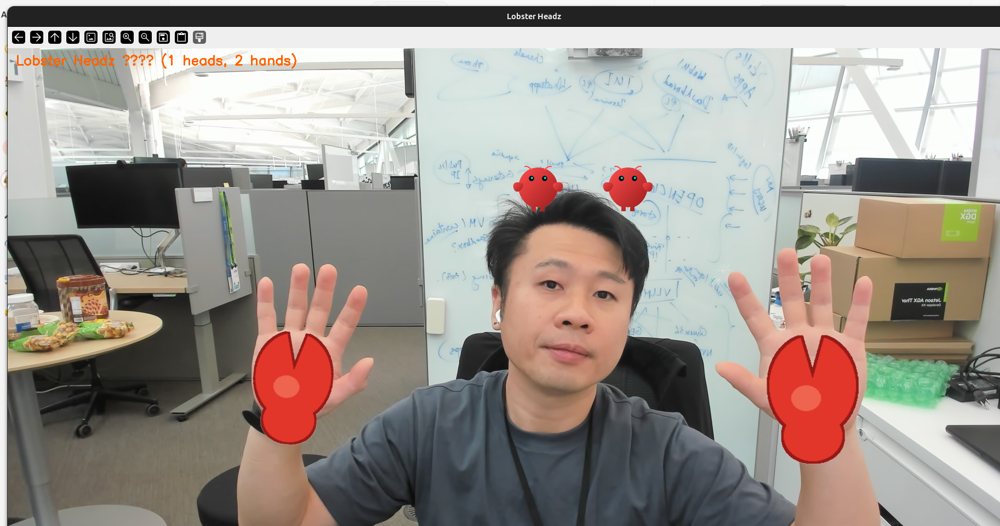

# 🦞 LobsterHeadz

Face-tracking webcam app that overlays two bouncy lobster images on people's heads in real-time.



> Put lobsters on people's heads. That's it. That's the app.

## Features

- Real-time face detection and tracking via MediaPipe Face Mesh
- Real-time hand detection and tracking via MediaPipe Hands
- 2 lobster overlays per detected face (side-by-side), up to 5 faces
- Lobster claw overlay on every detected hand, up to 4 hands
- Transparent PNG overlays with proper alpha blending
- Subtle bounce animation on the lobsters
- 1920×1080 @ 30fps via MJPEG pixel format
- Custom overlay images and camera options
- Resolves paths relative to script directory (no broken `~` paths)

## Install

### Prerequisites

- Python 3.9+
- A webcam (any OpenCV-compatible camera)
- Linux (tested on Ubuntu/Jetson), should work on macOS/Windows too

### Setup

```bash
# Clone the repo
git clone https://github.com/raymondlo84/lobsterheadz.git
cd lobsterheadz

# Install dependencies
pip3 install -r requirements.txt
```

## Run

```bash
# Default camera, bundled lobster overlay
DISPLAY=:1 python3 lobstercam.py --camera 0

# Custom camera index
DISPLAY=:1 python3 lobstercam.py --camera 1

# Custom overlay image (transparent PNG, preferably 256×256+)
DISPLAY=:1 python3 lobstercam.py --image /path/to/my-overlay.png

# Custom resolution
DISPLAY=:1 python3 lobstercam.py --width 1280 --height 720 --fps 24

# Custom claw overlay (transparent PNG) or disable hand tracking
DISPLAY=:1 python3 lobstercam.py --claw-image /path/to/my-claw.png
DISPLAY=:1 python3 lobstercam.py --no-claws

# Combine options
DISPLAY=:1 python3 lobstercam.py --camera 2 --image overlays/cat.png --width 1920 --height 1080
```

Press **Q** in the camera window to quit.

## Options

| Flag | Default | Description |
|------|---------|-------------|
| `--camera` | `0` | Camera device index |
| `--image` | bundled overlay | Path to overlay PNG image (lobsters on heads) |
| `--claw-image` | bundled claw | Path to claw overlay PNG (claws on hands) |
| `--no-claws` | off | Disable hand tracking and the claw overlay |
| `--width` | `1920` | Camera resolution width |
| `--height` | `1080` | Camera resolution height |
| `--fps` | `30` | Camera frame rate |

## Custom Overlays

Any transparent PNG works as an overlay. The bundled ones are `lobster_overlay.png` (heads) and `lobster_claw.png` (hands). Tips:

- **256×256** is the default size — scales automatically based on detected face/hand size
- Use a PNG with **alpha channel** (transparent background) for best results
- The image is centered and placed above the detected head
- You can create custom overlays with any image editor — GIFs, cartoon animals, hats, whatever

## How It Works

1. Opens webcam at specified resolution (default 1920×1080) via MJPEG for full 30fps
2. Uses MediaPipe Face Mesh to detect up to 5 faces simultaneously
3. Uses MediaPipe Hands to detect up to 4 hands simultaneously
4. Estimates head position from eyebrow landmarks (forehead midpoint, extrapolated upward)
5. Estimates hand position from wrist + middle-finger-base landmarks (palm center)
6. Places two overlay images side-by-side on each detected head, and one claw on each detected hand
7. Bounce animation adds a subtle vertical oscillation
8. Face size determines lobster scale and hand size determines claw scale — closer faces and hands get bigger overlays

## Dependencies

| Package | Version | Purpose |
|---------|---------|---------|
| `mediapipe` | 0.10.18 | Face mesh detection |
| `opencv-python` | 4.9.0.80 | Video capture & image processing |

## Install on OpenClaw

LobsterHeadz ships as an [OpenClaw skill](https://docs.openclaw.ai/tools/skills) — the repo root contains the required `SKILL.md`. Install it in one command:

```bash
openclaw skills install git:raymondlo84/lobsterheadz
```

- By default this lands in the active agent's workspace `skills/` directory; add `--global` to install into the shared managed skills directory instead.
- Pin a version with `git:raymondlo84/lobsterheadz@main` (or a branch/tag) if you want.
- Re-run with `--force` to overwrite a previous install.

Then set it up:

```bash
# 1. Install the Python dependencies (from the skill directory)
pip3 install -r ~/.openclaw/workspace/skills/lobsterheadz/requirements.txt

# 2. Verify the skill loaded
openclaw skills list
openclaw skills info lobsterheadz

# 3. Launch it (headless hosts: point DISPLAY at the screen you want)
DISPLAY=:1 python3 ~/.openclaw/workspace/skills/lobsterheadz/lobstercam.py --width 1920 --height 1080
```

Or skip the manual steps entirely and just ask your agent: **"run lobstercam"** — it finds the skill, launches the app, and the camera window appears. Press **Q** to quit.

### What the skill install checks

`openclaw skills install git:` verifies that the repo root has a loadable `SKILL.md` (YAML frontmatter with `name` and `description`) before copying anything, and names the installed skill from that frontmatter (`lobsterheadz`). After install, the skill watcher picks it up on the next agent turn; if you're already in a session, start a new one (`/new`) so the agent sees the refreshed skill list.

If you prefer to wire it up by hand instead of the CLI, the skill is just a directory containing:

- `SKILL.md` — skill description/instructions (frontmatter + usage)
- `lobstercam.py` — main application
- `lobster_overlay.png` — default overlay image
- `requirements.txt` — pinned Python dependencies

## License

MIT — do whatever you want with it. Just don't blame me when you look ridiculous.
